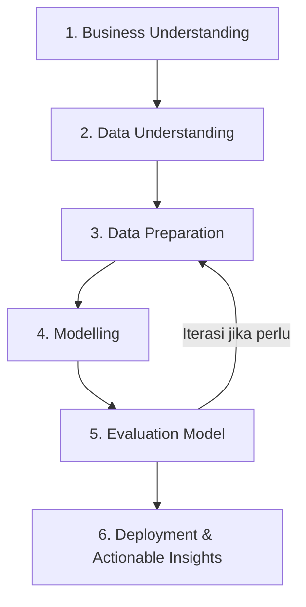

# 📖 Panduan Standar Struktur Jupyter Notebook Data Science (Berbasis CRISP-DM)

Dokumen ini merupakan **Standar Operasional & Panduan Penyusunan Jupyter Notebook (.ipynb)** yang diadopsi dari standar praktikum unggulan **DGX / FIKOM**. Panduan ini dirancang agar setiap notebook yang dibuat memiliki struktur yang rapi, *reproducible*, profesional, dan mudah dipahami baik untuk kepentingan akademik maupun industri.

---

## 🎯 Ringkasan Metodologi CRISP-DM

Setiap notebook Data Science dan Machine Learning mengikuti 6 tahapan utama metodologi **CRISP-DM** (*Cross-Industry Standard Process for Data Mining*):



---

## 📋 Struktur Lengkap Notebook (Template Standar)

Berikut adalah urutan hirarki cell markdown dan kode yang wajib ada di dalam notebook:

```
├── [MARKDOWN] Header Project & Identitas (FGD Praktikum DGX)
├── [MARKDOWN] Judul & Deskripsi Hands-on
├── [MARKDOWN] Tujuan Hands-on / Learning Outcomes
├── [MARKDOWN] Daftar Isi (HTML Anchor Links)
│
├── 1. Business Understanding (Latar Belakang, Problem Statement, & Goal)
├── 2. Data Understanding (Struktur, Statistik, & Visualisasi EDA)
├── 3. Data Preparation (Cleaning, Preprocessing, Splitting Data)
├── 4. Modelling (Inisialisasi & Training Model)
├── 5. Evaluation Model (Metrik Evaluasi & Visualisasi Hasil Prediksi)
└── 6. Deployment & Actionable Insights (Kesimpulan & Rekomendasi Strategis)
```

---

## 📑 Rincian Setiap Tahapan Notebook

### 0. Header & Daftar Isi (Navigation Anchor)

Setiap notebook diawali dengan header resmi, tujuan, dan **Daftar Isi interaktif menggunakan HTML Anchor Links** agar pembaca dapat melakukan navigasi dengan cepat.

```markdown
# Forum Group Discussion MK Praktikum Unggulan (Praktikum DGX)
---
Forum Group Discussion ini dilaksanakan sebagai wadah diskusi peserta untuk mendalami materi yang berkaitan dengan MK Praktikum Unggulan (Praktikum DGX), guna mendukung pemahaman konsep, analisis permasalahan, serta penerapan materi sesuai dengan ruang lingkup program studi.

# [Judul Proyek] (Contoh: Prediksi Efektivitas Media Iklan Menggunakan Data Periklanan)
---
Hands-on ini bertujuan untuk menganalisis dan memprediksi [tujuan proyek] berdasarkan data [nama dataset].

## Tujuan
Setelah menyelesaikan Hands-on ini, diharapkan peserta dapat:
* Melakukan EDA untuk memahami pola dan hubungan antar variabel pada dataset.
* Mengimplementasikan model [Nama Model, misal: Linear Regression / Random Forest / CNN] untuk prediksi nilai target.
* Mengevaluasi akurasi model menggunakan metrik evaluasi dan visualisasi hasil prediksi.

<a id='home'></a>
<h2>Daftar Isi</h2>

- <a href=#CRISP_DM>CRISP-DM</a>
- <a href=#Business>Business Understanding</a>
- <a href=#Understanding>Data Understanding</a>
- <a href=#Preparation>Data Preparation</a>
- <a href=#Modelling>Modelling</a>
- <a href=#Evaluation>Evaluation Model</a>
- <a href=#Deployment>Deployment & Rekomendasi</a>
```

---

### 1. Business Understanding

Menjelaskan konteks bisnis/domain, latar belakang masalah, alasan alokasi sumber daya, dan tujuan akhir proyek.

```markdown
<a id='Business'></a>
# 1. Business Understanding
<hr>

Dalam dunia [domain bisnis], perusahaan memerlukan pendekatan berbasis data untuk...

**Permasalahan Utama:**
Kurangnya pemahaman berbasis data dalam menentukan...

**Tujuan Project:**
* Mengidentifikasi pengaruh masing-masing variabel terhadap...
* Memprediksi nilai [Target Variable] secara akurat...
* Memberikan rekomendasi strategis untuk membantu pengambilan keputusan...
```

---

### 2. Data Understanding

Tahap eksplorasi data untuk memahami isi, tipe data, distribusi, serta mendeteksi anomaly/missing value.

```markdown
<a id='Understanding'></a>
# 2. Data Understanding
<hr>

Tahap Data Understanding ini bertujuan untuk:
* Memahami struktur dan isi dataset
* Mengidentifikasi variabel input (fitur) dan output (target)
* Menelaah data dengan metode statistik
* Menelaah data dengan metode visualisasi

Sumber Dataset: [Link Dataset Kaggle/Lokal]
```

#### Langkah Kode Data Understanding:

1. **Import Library Utama**:
   ```python
   import pandas as pd
   import numpy as np
   import matplotlib.pyplot as plt
   import seaborn as sns
   ```

2. **Memuat Dataset**:
   ```python
   df = pd.read_csv('nama_file.csv')
   df.head()
   ```

3. **Jumlah Data & Struktur**:
   ```python
   baris, kolom = df.shape
   print("Jumlah baris: ", baris)
   print("Jumlah kolom: ", kolom)
   ```

4. **Pemeriksaan Tipe Data & Statistik**:
   ```python
   df.info()
   df.describe()
   ```

5. **Pembersihan Nama Kolom & Cek Duplikat**:
   ```python
   # Mengubah nama kolom jika ada kolom index bawaan (misal 'Unnamed: 0')
   if 'Unnamed: 0' in df.columns:
       df.rename(columns={'Unnamed: 0': 'ID'}, inplace=True)

   # Cek jumlah duplikat
   print("Jumlah nilai duplikat: ", df.duplicated().sum())
   ```

6. **Visualisasi Exploratory Data Analysis (EDA)**:
   ```python
   # Histrogram Distribusi Data
   df.hist(figsize=(15, 11))
   plt.tight_layout()
   plt.show()

   # Heatmap Korelasi antar Variabel
   plt.figure(figsize=(10, 6))
   sns.heatmap(df.corr(numeric_only=True), annot=True, cmap='coolwarm', fmt=".2f")
   plt.title("Heatmap Korelasi Variabel")
   plt.show()
   ```

---

### 3. Data Preparation

Mempersiapkan data agar siap dimasukkan ke dalam model pembelajaran mesin.

```markdown
<a id='Preparation'></a>
# 3. Data Preparation
<hr>

Tahap Data Preparation meliputi:
* Pemisahan variabel independen (Fitur / X) dan variabel dependen (Target / y)
* Pembagian data menjadi Data Latih (Train) dan Data Uji (Test)
* [Opsional] Feature Scaling / Encoding
```

#### Langkah Kode Data Preparation:

```python
from sklearn.model_selection import train_test_split

# 1. Menentukan Fitur (X) dan Target (y)
X = df.drop(columns=['Sales']) # Sesuaikan dengan nama kolom target
y = df['Sales']

# 2. Pembagian Data (Train & Test Split 80:20)
X_train, X_test, y_train, y_test = train_test_split(
    X, y, test_size=0.2, random_state=42
)

print(f"Jumlah Data Latih (X_train): {X_train.shape[0]}")
print(f"Jumlah Data Uji (X_test): {X_test.shape[0]}")
```

---

### 4. Modelling

Memilih, menginisialisasi, dan melatih model Machine Learning / Deep Learning.

```markdown
<a id='Modelling'></a>
# 4. Modelling
<hr>

Pada tahap ini digunakan algoritma **[Nama Algoritma, contoh: Linear Regression]** untuk membangun model prediktif.
```

#### Langkah Kode Modelling:

```python
from sklearn.linear_model import LinearRegression

# 1. Inisialisasi Model
model = LinearRegression()

# 2. Pelatihan Model (Fit Data Train)
model.fit(X_train, y_train)

# 3. Menampilkan Parameter Model (Koefisien & Intercept jika Regresi)
print("Intercept (b0):", model.intercept_)
for col, coef in zip(X.columns, model.coef_):
    print(f"Koefisien {col}: {coef:.4f}")
```

---

### 5. Evaluation Model

Mengukur performa model pada data uji menggunakan metrik kuantitatif dan visualisasi aktual vs prediksi.

```markdown
<a id='Evaluation'></a>
# 5. Evaluation Model
<hr>

Evaluasi dilakukan menggunakan metrik evaluasi [Regresi/Klasifikasi] untuk mengetahui tingkat akurasi dan presisi model pada data yang belum pernah dilihat sebelumnya (Data Test).
```

#### Langkah Kode Evaluation (Contoh Regresi):

```python
from sklearn.metrics import mean_absolute_error, mean_squared_error, r2_score

# 1. Prediksi Data Test
y_pred = model.predict(X_test)

# 2. Perhitungan Metrik Evaluasi
mae = mean_absolute_error(y_test, y_pred)
mse = mean_squared_error(y_test, y_pred)
rmse = np.sqrt(mse)
r2 = r2_score(y_test, y_pred)

print(f"Mean Absolute Error (MAE) : {mae:.4f}")
print(f"Mean Squared Error (MSE)  : {mse:.4f}")
print(f"Root Mean Squared Error (RMSE): {rmse:.4f}")
print(f"R-Squared (R2 Score)      : {r2:.4f}")

# 3. Visualisasi Hasil Prediksi vs Nilai Aktual
plt.figure(figsize=(8, 6))
plt.scatter(y_test, y_pred, color='blue', alpha=0.7)
plt.plot([y_test.min(), y_test.max()], [y_test.min(), y_test.max()], 'r--', lw=2)
plt.xlabel("Nilai Aktual (Actual Sales)")
plt.ylabel("Nilai Prediksi (Predicted Sales)")
plt.title("Visualisasi Nilai Aktual vs Nilai Prediksi")
plt.grid(True)
plt.show()
```

---

### 6. Deployment & Actionable Insights

Menjelaskan kesimpulan berbasis data, rekomendasi strategi bagi keputusan bisnis, dan penutup.

```markdown
<a id='Deployment'></a>
# 6. Deployment & Actionable Insights
<hr>

Berdasarkan hasil analisis dan pemodelan, dapat ditarik beberapa kesimpulan dan rekomendasi bisnis:

### Kesimpulan Utama:
1. **Model Accuracy**: Model berhasil menjelaskan **X%** variansi data target ($R^2$ = ...).
2. **Pengaruh Variabel**: [Variabel A] memberikan dampak positif paling signifikan terhadap [Target].

### Rekomendasi Strategis:
* **Alokasi Anggaran**: Alokasikan anggaran lebih tinggi pada saluran [Variabel A].
* **Efisiensi**: Evaluasi pengeluaran pada saluran [Variabel C] karena kontribusinya relatif rendah.
* **Langkah Selanjutnya**: Melakukan eksperimen lebih lanjut menggunakan model non-linear (seperti Random Forest/XGBoost) atau menambahkan fitur eksternal.
```

---

## 🛠️ Penyesuaian Berdasarkan Tipe Proyek

### A. Proyek EDA Murni (Tanpa Pemodelan)
* Hilangkan Bab **4 (Modelling)** dan **5 (Evaluation Model)**.
* Perluas Bab **2 (Data Understanding)** dengan menyertakan *Deep Dive Visualisations* (Bivariate, Multivariate, Groupby Aggregations, Storytelling Data).
* Bab **6 (Deployment)** diganti menjadi **Business Insights & Recommendations**.

### B. Proyek Klasifikasi (Machine Learning)
* Pada Bab **5 (Evaluation)**, gunakan metrik klasifikasi:
  ```python
  from sklearn.metrics import classification_report, confusion_matrix, roc_auc_score
  print(classification_report(y_test, y_pred))
  sns.heatmap(confusion_matrix(y_test, y_pred), annot=True, fmt='d')
  ```

### C. Proyek Deep Learning (PyTorch / TensorFlow)
* Pada Bab **4 (Modelling)**, sertakan ringkasan arsitektur `model.summary()` atau `print(model)`.
* Pada Bab **5 (Evaluation)**, sertakan grafik **Loss & Accuracy Curve** sepanjang Epoch:
  ```python
  plt.plot(history.history['loss'], label='Train Loss')
  plt.plot(history.history['val_loss'], label='Val Loss')
  plt.legend()
  plt.show()
  ```

---

## 💡 Best Practices Kebersihan Kode & Cell

1. **Cell Modular & Terfokus**: 1 cell kode hendaknya menjalankan 1 fungsi/langkah saja.
2. **Keterangan Markdown di Setiap Cell**: Berikan penjelas singkat dalam bentuk markdown sebelum/sesudah baris kode penting untuk menjelaskan makna hasil output.
3. **Pembersihan Output Besar**: Hindari membiarkan output error yang sangat panjang atau print log yang tidak perlu.
4. **Random State Consistency**: Selalu gunakan `random_state=42` agar hasil latihan dan evaluasi konsisten ketika di-run ulang (*reproducible*).

---
*Dibuat untuk Standar Praktikum DGX / FIKOM Data Science Project Guideline.*
