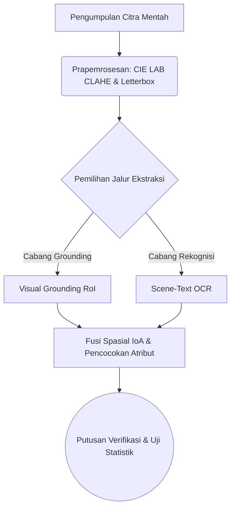

# STANDAR OPERASIONAL & TEMPLATE: BAB II TINJAUAN PUSTAKA
> Dokumen referensi resmi penulisan Bab 2 Tinjauan Pustaka (Standar Akademik Q1 & Pedoman Skripsi/Tesis Universitas di Indonesia).

---

## 🏛️ PEDOMAN ARSITEKTUR BAB II (RULES & CONSTRAINTS)

### 1. Landasan Teori (Theoretical Framework)
- **Kredibilitas & Kebaruan (Recency)**: 
  - Wajib rujukan 5 tahun terakhir untuk teknologi/metode, kecuali *Grand Theory* fundamental.
  - HANYA mengutip jurnal/prosiding *Peer-Reviewed* atau buku teks resmi. **DILARANG KERAS** mengutip Wikipedia, Blog, atau portal berita untuk konsep sains.
- **Hierarki Deduktif (Umum ke Khusus)**: Susun sub-bab dari *Grand Theory* (Topik Makro) $\rightarrow$ Variabel Terikat (Y) $\rightarrow$ Variabel Bebas/Teknis (X).
- **Aturan Anti-Padding (Relevansi Mutlak)**: Hanya masukkan teori yang benar-benar akan digunakan sebagai pisau analisis atau diimplementasikan di Bab 3 (Metodologi). Buang teori *filler* yang menebalkan halaman tanpa makna.
- **Definisi Konseptual (Sintesis)**: Dilarang terkena *Dictionary Syndrome* (menjejerkan "Menurut A...", "Menurut B..."). Wajib merajut 3 pandangan ahli menjadi **1 paragraf sintesis** kesimpulan mandiri.
- **Rumus Matematika & Gambar**:
  - Rumus wajib diformat LaTeX Math (`$$...$$`) lalu diikuti **Tabel Dekomposisi Variabel** (simbol, arti, dan satuan SI).
  - Gambar wajib menggunakan format `` dilengkapi dengan kunci sitasi sumber aslinya `[@citekey]`.
- **Teori Usang**: Jika terpaksa membahas teori lama yang sudah dibantah, sertakan `> [!warning] Outdated Theory` dan bedah kelemahannya berdasarkan literatur modern.

### 2. Penelitian Terdahulu (State-of-the-Art / SOTA)
- **Jumlah**: Bedah secara komprehensif **5 hingga 10 paper** utama (paling relevan).
- **Empat Pilar Narasi**: Setiap paper yang dibahas harus mencakup: (1) Penulis & Tahun, (2) Masalah Riset, (3) Metode/Algoritma, dan (4) Hasil Temuan & Keterbatasannya.
- **Matriks SOTA (Wajib)**: Setelah narasi paragraf, WAJIB merangkumnya ke dalam tabel **Matriks Komparasi Penelitian Terdahulu**.
- **Kolom Krusial**: Tabel Matriks WAJIB memiliki kolom **"Perbedaan / Posisi Penelitian Ini"** untuk membuktikan *Novelty* (Pembaruan) skripsi Anda secara *apple-to-apple*.
- **Penutup**: Akhiri sub-bab ini dengan **Paragraf Sintesis Research Gap** (Benang merah yang menegaskan kelemahan kolektif paper sebelumnya dan justifikasi solusi Anda).

### 3. Kerangka Pemikiran & Hipotesis
- **Visualisasi & Narasi**: Wajib menyediakan **Diagram Alur Visual** (via kode Mermaid `graph TD` atau `flowchart LR`) yang menunjukkan alur Input $\rightarrow$ Proses $\rightarrow$ Output. SETELAH diagram, wajib berikan paragraf **Bedah Narasi** yang menguraikan logika panah tersebut.
- **Hipotesis (Hanya untuk Riset Kuantitatif)**:
  - Wajib *Testable* (Dapat Diuji secara statistik), memuat $H_0$ dan $H_1$.
  - Umumnya ditempatkan di akhir Bab 2 atau awal Bab 3.
- **Pengecualian (Rancang Bangun)**: Jika penelitian bersifat murni Rancang Bangun/Rekayasa Perangkat Lunak (tanpa uji statistik/korelasi antar variabel), **Sub-bab Hipotesis DIBUANG / DIHAPUS**.

### 4. Etika Penulisan & Anti-Plagiarisme
- **Reporting Verbs (Kata Kerja Pelaporan)**: Gunakan variasi kata kerja kritis (contoh: *menentang, mengusulkan, membuktikan, menyoroti*). Hindari pengulangan monoton kata "mengatakan".
- **Parafrase Tingkat Tinggi**: Lakukan *Restrukturisasi Total* (Ubah aktif ke pasif, induktif ke deduktif) sambil mempertahankan makna. Dilarang melakukan *Direct Quote* (Kutipan mentah) atau sekadar sinonim (*Spintax*).
- **Standar Sitasi**: Wajib menggunakan *Markdown Citation Keys* (contoh: `[@penulis2024]`).
- **Self-Citation**: Jika mengutip paper sendiri, tulis secara objektif (sudut pandang pihak ketiga) tanpa puji-pujian personal.
- **Hard-Reject Word-Vomit**: Agen akan MENOLAK perintah untuk menebalkan halaman (*padding*). Draf akan dikompresi agar tajam, logis, dan langsung pada intinya.

---

## 📝 SPESIFIKASI PARAGRAPH STYLE FISIK JUDUL & TEMPLATE BAB II (KORPUS PDF UPNVJ)

### A. Telemetri Fisik Paragraph Style Judul Bab 2 (`E:\SKRIPSI_UPNVJ_PDF`)
Berdasarkan ekstraksi koordinat vektor (`PyMuPDF/fitz`) pada berkas PDF Bab 2 Fakultas Ilmu Komputer UPNVJ, tata letak fisik judul wajib memenuhi parameter berikut:
1. **Judul Bab Utama (`Heading 1`)**:
   - Terdiri dari 2 baris terpisah rata tengah (*Center*): Baris 1 `BAB II` (atau `2.`) dan Baris 2 `TINJAUAN PUSTAKA` (atau `LANDASAN TEORI`).
   - Font: `Times New Roman 12 pt / 14 pt Bold`, seluruh huruf kapital (*ALL CAPS*), jarak vertikal ke sub-bab `2.1` sebesar `47.0 s/d 56.0 pt` (~2,5 sampai 3 spasi).
2. **Judul Sub-Bab Tingkat 2 (`Heading 2` - contoh: `2.1`, `2.2`, `2.3`)**:
   - Panjang teks judul: **Wajib 1 sampai 2 kata benda entitas murni** (maksimal 3 kata hanya untuk nama algoritma baku seperti *Convolutional Neural Network*). DILARANG menggunakan kata hubung `dan` / `&` / `/` yang menggabungkan dua konsep (seperti *"Arsitektur Model dan Fungsi Objektif"*).
   - Font: `Times New Roman 12 pt Bold`, kapitalisasi *Title Case*. Istilah bahasa Inggris pada judul wajib dicetak **Tebal Miring (*Bold Italic*)** (contoh: **2.3 *Deep Learning***, **2.5 *Random Forest***, **2.7 *Confusion Matrix***, **2.8 *Black Box Testing***).
   - **Indentasi Gantung (*Hanging Indent*) 36.0 pt (1,27 cm)**:
     - Nomor sub-bab (`2.1`) rata margin kiri di `x = 113.4 pt` (`leftIndent = 0 pt`).
     - Teks judul sub-bab dimulai tepat di `x = 149.4 pt` (`hangingIndent / tabStop = 36.0 pt`), **sejajar tegak lurus sempurna dengan huruf pertama baris ke-1 paragraf narasi di bawahnya (`firstLineIndent = 36.0 pt`)**.
3. **Judul Sub-Sub-Bab Tingkat 3 (`Heading 3` - contoh: `2.4.1`, `2.4.2`)**:
   - Panjang teks judul: **Wajib 1 sampai 2 kata murni** (contoh: **2.4.1 *Convolutional Layer***, **2.4.2 *Batch Normalization***, **2.4.3 *Pooling Layer***, **2.4.4 *Softmax***).
   - Font: `Times New Roman 12 pt Bold` (*Bold Italic* untuk istilah bahasa Inggris).
   - **Indentasi Bertingkat (*Nested Hanging Indent*) +36.0 pt**:
     - Nomor sub-sub-bab (`2.4.1`) dimulai di `x = 148.6 s/d 149.4 pt` (`leftIndent = 36.0 pt`, sejajar vertikal dengan teks judul `2.4`).
     - Teks judul sub-sub-bab dimulai di `x = 184.6 s/d 185.4 pt` (`tabStop = 72.0 pt` / 2,54 cm dari margin kiri).

---

### B. Template Naskah Bab II (Standar Judul 1-2 Kata Korpus FIK UPNVJ)

```markdown
# BAB II TINJAUAN PUSTAKA

## 2.1 Tanaman Selada
Tanaman selada merupakan komoditas hortikultura daun dari famili Asteraceae yang bernilai ekonomis tinggi dan dibudidayakan secara luas melalui sistem hidroponik (Rosita, Wibowo, dan Putri, 2020). Secara fisiologis, kualitas pertumbuhan tanaman selada ditentukan oleh kecukupan unsur hara terlarut, intensitas pencahayaan, serta stabilitas pH air nutrisi pada rentang 5,5 hingga 6,5. Gangguan penyerapan nutrisi atau serangan patogen pada fase vegetatif memicu perubahan morfologi daun berupa klorosis kuning, bercak nekrotik cokelat, hingga pengeritingan tepi daun. Oleh sebab itu, karakteristik visual permukaan daun menjadi indikator fisik utama dalam membangun sistem klasifikasi kondisi kesehatan tanaman secara otomatis.

## 2.2 Citra Digital
Citra digital merupakan representasi visual dua dimensi $f(x, y)$ yang terbentuk dari kuantisasi sinyal optik kontinu menjadi matriks elemen gambar diskrit atau piksel (Gonzalez dan Woods, 2018). Pada fungsi matematis tersebut, pasangan koordinat spasial $(x, y)$ menentukan posisi titik pada bidang matriks berukuran $M \times N$, sedangkan nilai amplitudo $f$ merepresentasikan intensitas luminansi atau kanal warna RGB pada rentang integer $[0, 255]$. Struktur matriks numerik ini memungkinkan operasi transformasi ruang warna dan penyaringan konvolusi dieksekusi secara komputasional, namun variasi iluminasi saat pengambilan gambar dapat menggeser distribusi histogram piksel. Sehubungan dengan hal tersebut, penelitian ini menerapkan normalisasi skala piksel dan penyesuaian ukuran citra menjadi $224 \times 224$ piksel sebelum diproses oleh jaringan saraf tiruan.

## 2.3 *Deep Learning*
*Deep learning* merupakan subbidang pembelajaran mesin yang menggunakan arsitektur jaringan saraf tiruan berlapis banyak untuk mengekstraksi representasi fitur data secara hierarkis (Lecun, Bengio, dan Hinton, 2015). Berbeda dengan pembelajaran mesin konvensional yang bergantung pada rekayasa fitur manual, lapisan tersembunyi pada *deep learning* mempelajari pola spasial dari tingkat rendah seperti tepi dan gradien warna menuju fitur semantik tingkat tinggi secara mandiri melalui algoritma propagasi balik. Kemampuan generalisasi tersebut sangat efektif pada data citra berdimensi besar, meskipun memerlukan regulasi bobot untuk mencegah *overfitting* pada dataset berukuran terbatas. Berdasarkan keunggulan tersebut, paradigma *deep learning* dipilih sebagai fondasi pemodelan klasifikasi citra pada penelitian ini.

## 2.4 *Convolutional Neural Network*
*Convolutional Neural Network* (CNN) merupakan arsitektur *deep learning* yang dirancang khusus untuk memproses data berstruktur kisi dua dimensi melalui operasi konvolusi spasial (O'Shea dan Nash, 2015). Jaringan CNN tersusun atas tiga komponen ekstraksi dan klasifikasi utama yang bekerja secara berurutan dari masukan citra hingga vektor probabilitas kelas.

### 2.4.1 *Convolutional Layer*
*Convolutional layer* merupakan lapisan inti yang berfungsi mengekstraksi peta fitur (*feature map*) melalui perkalian titik antara matriks masukan dan kernel filter berukuran $k \times k$ yang bergeser sebesar nilai *stride* tertentu.

### 2.4.2 *Pooling Layer*
*Pooling layer* merupakan lapisan reduksi dimensi spasial yang mengambil nilai maksimum (*max pooling*) atau nilai rata-rata (*average pooling*) pada jendela lokal guna menurunkan beban parameter komputasi dan menjaga sifat invarian translasi.

### 2.4.3 *Softmax*
*Softmax* merupakan fungsi aktivasi pada lapisan keluaran akhir yang mentransformasikan vektor nilai logit mentah menjadi distribusi probabilitas kelas pada rentang $[0, 1]$. Optimasi bobot jaringan selama pelatihan dikendalikan menggunakan fungsi kerugian *categorical cross-entropy* sebagaimana diekspresikan pada Persamaan (2.1):

$$ L(y, \hat{y}) = -\frac{1}{N} \sum_{i=1}^{N} y_i \log(\hat{y}_i) \quad (2.1) $$

Tabel 2.1 Dekomposisi Variabel Persamaan Cross-Entropy
| Simbol | Deskripsi | Satuan / Rentang |
|:---:|:---|:---:|
| $L$ | Nilai fungsi kerugian | $[0, \infty)$ |
| $N$ | Jumlah sampel dalam satu *batch* | Integer |
| $y_i$ | Nilai target aktual (*ground truth*) | $\{0, 1\}$ |
| $\hat{y}_i$ | Probabilitas prediksi dari jaringan model | $[0, 1]$ |

## 2.5 MobileNetV2
MobileNetV2 merupakan arsitektur jaringan konvolusional ringan yang mengimplementasikan blok *inverted residual* dan *depthwise separable convolution* untuk menekan jumlah parameter komputasi (Sandler, Howard, Zhu, Zhmoginov, dan Chen, 2018). Mekanisme tersebut memisahkan proses penyaringan spasial per kanal (*depthwise*) dan penggabungan linier antarkanal (*pointwise* $1 \times 1$), sehingga menurunkan kompleksitas perkalian matriks hingga delapan kali lipat dibandingkan konvolusi standar.

## 2.6 Python
Python merupakan bahasa pemrograman tingkat tinggi berorientasi objek yang dilengkapi ekosistem pustaka komputasi matriks dan pembelajaran mesin seperti TensorFlow, PyTorch, NumPy, dan OpenCV.

## 2.7 Evaluasi Model
Evaluasi model merupakan tahapan pengukuran kinerja kuantitatif algoritma klasifikasi menggunakan tabel silang *confusion matrix* untuk menghitung nilai akurasi, *precision*, *recall*, dan *F1-score*.

## 2.8 Penelitian Terdahulu
Penelitian ini dibangun di atas evaluasi kritis terhadap studi terdahulu yang berfokus pada klasifikasi dan deteksi objek berbasis citra digital.

Penelitian pertama oleh PenulisA, PenulisB, dan PenulisC (2022) mengevaluasi masalah inefisiensi waktu komputasi deteksi objek pada perangkat bergerak. Studi tersebut menerapkan arsitektur MobileNetV3 dan mencatat akurasi sebesar 92,00% pada laju 30 FPS. Meskipun efisien secara komputasi, model tersebut mengalami penurunan akurasi yang tajam pada citra dengan pencahayaan minim.

Selanjutnya, PenulisD dan PenulisE (2023) mengintegrasikan modul *spatial attention* pada jaringan konvolusional untuk mengatasi degradasi iluminasi pada dataset NightVision-DB. Pendekatan tersebut meningkatkan akurasi hingga 95,50%, namun membutuhkan alokasi memori VRAM yang besar sehingga tidak dapat dijalankan pada infrastruktur komputasi terbatas.

[Lanjutkan sintesis 5-10 paper utama dengan pola 4-unsur: Penulis & Tahun First-Mention -> Masalah & Objek -> Metode -> Capaian Metrik Kuantitatif & Keterbatasan...]

Tabel 2.2 Penelitian Terdahulu

| Penulis dan Tahun | Tautan Artikel | Latar Belakang Masalah | Hasil Capaian Kuantitatif | Kesimpulan Studi | Relevansi Terhadap Penelitian Ini |
|:---|:---|:---|:---|:---|:---|
| PenulisA, PenulisB, dan PenulisC (2022) | [DOI / URL] | Deteksi objek cepat pada perangkat bergerak | Akurasi mencapai 92,00% pada 30 FPS | Arsitektur efisien namun akurasi menurun pada pencahayaan minim | Menjadi pembanding model ringan; penelitian ini menambahkan normalisasi kontras CIE LAB CLAHE |
| PenulisD dan PenulisE (2023) | [DOI / URL] | Optimasi akurasi pada variasi pencahayaan ekstrem | Akurasi mencapai 95,50% namun membutuhkan memori besar | Modul *attention* efektif meningkatkan akurasi namun beban VRAM tinggi | Mengadopsi isolasi *Region of Interest* terarah agar tetap hemat memori |
| **Penelitian Ini** | - | Evaluasi komparatif model pada kondisi pencahayaan dan kemasan dinamis | Target akurasi > 85,00% dengan uji signifikansi statistik | Komparasi empiris terkontrol dengan partisi data anti-bocor | **Mengisi celah efisiensi dan ketangguhan melalui pipeline hibrida terverifikasi** |

Berdasarkan komparasi pada Tabel 2.2, celah penelitian (*research gap*) yang belum diselesaikan oleh literatur terdahulu adalah ketiadaan arsitektur yang mampu menjaga presisi ekstraksi fitur pada kondisi pencahayaan tidak merata tanpa mengorbankan efisiensi komputasi. Oleh karena itu, penelitian ini diposisikan untuk mengisi celah tersebut melalui penggabungan lokalisasi wilayah terarah dan pengenalan karakter berpresisi tinggi.

## 2.9 Kerangka Pemikiran
Kerangka pemikiran memetakan alur logika penelitian dari identifikasi masalah hingga evaluasi akhir. Secara konseptual, tahapan sistem yang diusulkan divisualisasikan pada Gambar 2.1:


Gambar 2.1 Skema Kerangka Pemikiran Konseptual Sistem

Berdasarkan Gambar 2.1, aliran pemrosesan dimulai dari akuisisi citra mentah yang kemudian dikenakan normalisasi kontras CIE LAB CLAHE untuk meratakan distribusi luminansi sebelum penempatan kanvas *letterbox*. Sistem selanjutnya menjalankan dua cabang pemrosesan paralel: cabang pertama melokalisasi wilayah kandidat menggunakan *visual grounding*, sedangkan cabang kedua mengekstraksi deretan karakter menggunakan mesin OCR, yang kemudian digabungkan melalui aturan fusi spasial untuk menghasilkan putusan verifikasi akhir.

## 2.10 Hipotesis Penelitian
*(Catatan: Hapus sub-bab ini jika penelitian murni berjenis Rancang Bangun/Rekayasa Perangkat Lunak)*

Berdasarkan kajian pustaka dan kerangka pemikiran di atas, hipotesis yang diajukan dalam penelitian ini adalah:
- **$H_0$**: Tidak terdapat perbedaan akurasi dan latensi inferensi yang signifikan antara model konvensional dan arsitektur hibrida yang diusulkan.
- **$H_1$**: Arsitektur hibrida yang diusulkan memiliki tingkat akurasi yang lebih tinggi dengan latensi inferensi yang tetap kompetitif secara statistik dibandingkan model konvensional.
```
