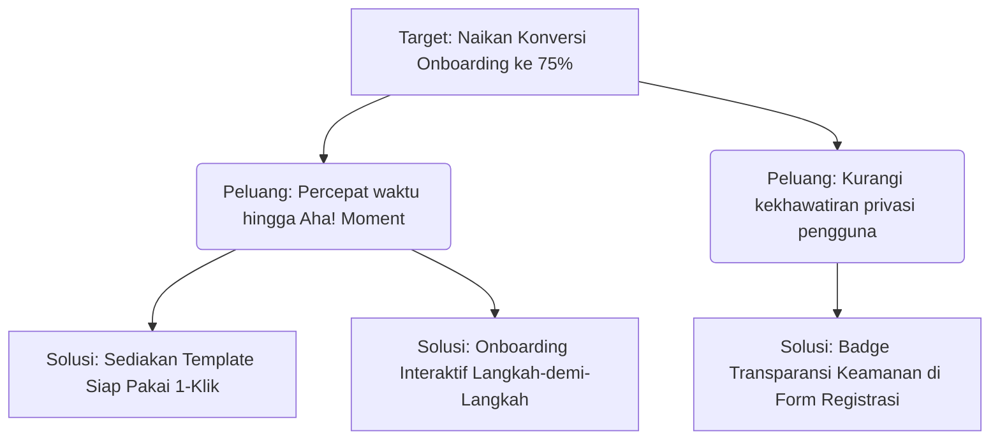

# STANDAR OPERASIONAL & TEMPLATE: USER RESEARCH SYNTHESIS
> Kerangka kerja sintesis data kualitatif dan wawancara pengguna berbasis Opportunity Solution Tree (OST).

---

## 🏛️ PRINSIP SINTESIS RISET PENGGUNA
1. **Quantified Qualitative**: Kuantifikasi temuan kualitatif (misal: "7 dari 10 responden mengalami friksi pada langkah X").
2. **Verbatim Evidence**: Sertakan kutipan langsung kata-kata pengguna untuk membuktikan keaslian temuan rasa sakit (*pain-point*).
3. **Outcome Over Feature**: Fokus pada hasil akhir yang diinginkan pengguna (*Desired Outcome*), bukan fitur yang mereka minta secara lisan.

---

## 📝 TEMPLATE STRUKTUR USER RESEARCH SYNTHESIS

```markdown
# User Research Synthesis: [Topik Riset / Eksperimen]
**Tanggal Riset**: YYYY-MM-DD  
**Metodologi**: 1-on-1 Interviews (N=10) / Usability Testing / Survey (N=150)  
**Peneliti**: Pram & Tim Riset Produk

## 1. Executive Summary & Temuan Kunci
1. **Friksi Utama**: Pengguna kesulitan memahami perbedaan antara fitur A dan fitur B saat pertama kali membuka dashboard.
2. **Aha! Moment**: Pengguna merasa puas dan berkomitmen menggunakan aplikasi ketika fitur otomatisasi pertama berhasil dieksekusi dalam < 1 menit.
3. **Kehilangan Minat (Drop-off)**: 60% pengguna meninggalkan proses onboarding pada tahap verifikasi data yang terlalu rumit.

## 2. Klaster Masalah & Analisis Frekuensi (Pain-Points)
| Tema Masalah | Frekuensi (N=10) | Tingkat Keparahan | Bukti Kutipan Pengguna (Verbatim Quote) |
|---|:---:|:---:|---|
| **Kompleksitas Navigasi** | 8 / 10 | Tinggi | *"Saya bingung tombol untuk menyimpan draft ada di mana, saya kira otomatis tersimpan."* |
| **Kekhawatiran Privasi** | 6 / 10 | Sedang | *"Saya tidak mau menghubungkan akun sebelum tahu data apa saja yang kalian baca."* |
| **Kurangnya Feedback Visual** | 5 / 10 | Rendah | *"Saat loading, layarnya diam saja seperti aplikasi sedang hang."* |

## 3. Opportunity Solution Tree (OST)


## 4. Rekomendasi Aksi untuk PRD / Roadmap
- **P0**: Redesain alur pendaftaran dengan menunda verifikasi data non-esensial ke pengaturan akun (*Lazy Verification*).
- **P0**: Pasang indikator loading skeleton dan progress bar saat sistem memproses data.
- **P1**: Buat 3 template siap pakai pada halaman utama dashboard untuk mempercepat aktivasi pengguna baru.
```
