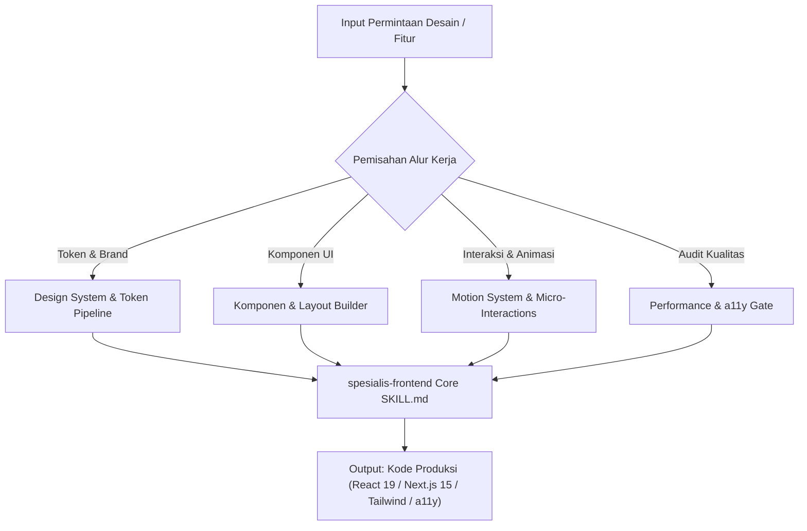

# Technical Design: Arsitektur spesialis-frontend v3.0.0

## Document Information
- **ID Desain**: DESIGN-FE-UPGRADE-V3
- **Dasar Requirements**: `requirements.md` (SPEC-FE-UPGRADE-V3)
- **Status**: DRAFT

---

## 1. Overview & Arsitektur Sistem

Modul `spesialis-frontend` v3.0.0 berevolusi dari sekadar pelaksana slicing menjadi mesin rekayasa antarmuka enterprise lengkap. Sistem menstrukturkan alur kerja agen ke dalam 4 pilar rekayasa terpadu:



---

## 2. Struktur Komponen & Modul Referensi

Untuk memenuhi NFR-1 (efisiensi context window < 5.000 token pada `SKILL.md`), detail teknis dieksternalisasi ke 3 modul referensi baru di `references/`:

```
skills/spesialis-frontend/
├── SKILL.md (Entrypoint terpadu v3.0.0 - < 4.000 token)
├── .kiro/
│   └── specs/upgrade-v3/
│       ├── requirements.md
│       ├── design.md
│       └── tasks.md
└── references/
    ├── wcag-accessibility-handbook.md (Panduan a11y, ARIA, focus trap)
    ├── core-web-vitals-performance.md (Teknik INP, LCP, CLS, dynamic import)
    ├── react19-next15-patterns.md (Server Action, useActionState, boundaries)
    ├── agency-grade-ui.md (Eksisting)
    ├── anti-ui-slop.md (Eksisting)
    ├── motion-ui.md (Eksisting)
    └── [50 Brand References] (Eksisting)
```

---

## 3. Komponen Spesifikasi & Kontrak Antarmuka

### 3.1. Sub-Modul 1: WCAG Accessibility Handbook (`wcag-accessibility-handbook.md`)
- **Fokus**: Pola form semantics, focus trapping pada modal, pengumuman status live ARIA, dan keyboard navigation pattern (Escape, Arrow navigation).
- **Format**: Snippet React + TypeScript siap pakai tanpa pustaka eksternal pihak ketiga jika memungkinkan.

### 3.2. Sub-Modul 2: Core Web Vitals Engine (`core-web-vitals-performance.md`)
- **Fokus**: Optimasi LCP dengan Next.js Image priority, pencegahan CLS dengan skeleton aspect-ratio, pemangkasan bundle dengan `next/dynamic`, dan optimasi INP via `startTransition`.
- **Format**: Aturan koding performa dan daftar checklist pra-rilis.

### 3.3. Sub-Modul 3: React 19 & Next.js 15 Blueprint (`react19-next15-patterns.md`)
- **Fokus**: `'use client'` discipline (daun pohon komponen), `useActionState` untuk mutasi form dengan state error, optimasi `useOptimistic` untuk instan feedback UI.
- **Format**: Pola referensi implementasi enterprise.

---

## 4. Keamanan & Penanganan Error
- **Sanitasi Masukan**: Pencegahan celah XSS dengan menghindari penggunaan `dangerouslySetInnerHTML` kecuali telah melewati proses sanitasi murni.
- **Error Boundary**: Setiap komponen besar yang memuat data eksternal wajib dibungkus dalam batas kesalahan (Error Boundary) dengan status fallback yang elegan.

---

## 5. Strategi Pengujian (Testing Strategy)
- Pengujian unit dan integrasi berbasis **React Testing Library** + **Vitest**.
- Menitikberatkan pengujian pada perspektif pengguna:
  - Query berbasis role (`getByRole('button', { name: /kirim/i })`)
  - Verifikasi perubahan ARIA state pada interaksi keyboard

---

## 6. Checklist Kesiapan Desain (Design Gate)
- [x] Arsitektur memenuhi batas efisiensi token
- [x] Traceability penuh ke requirements FR-1 sampai FR-5
- [x] Ketiadaan karakter em dash / en dash
- [x] Kompatibilitas mundur terhadap 50+ brand reference lama
