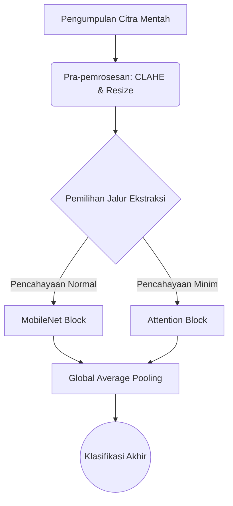

# STANDAR OPERASIONAL & TEMPLATE: BAB II TINJAUAN PUSTAKA
> Dokumen referensi resmi penulisan Bab 2 Tinjauan Pustaka (Standar Akademik Q1 & Pedoman Skripsi/Tesis Universitas di Indonesia).

---

## 🏛️ PEDOMAN ARSITEKTUR BAB II (RULES & CONSTRAINTS)

### 1. Landasan Teori (Theoretical Framework)
- **Kredibilitas & Kebaruan (Recency)**: 
  - Wajib rujukan 5 tahun terakhir untuk teknologi/metode, kecuali *Grand Theory* fundamental.
  - HANYA mengutip jurnal/prosiding *Peer-Reviewed* atau buku teks resmi. **DILARANG KERAS** mengutip Wikipedia, Blog, atau portal berita untuk konsep sains.
- **Hierarki Deduktif (Umum ke Khusus)**: Susun sub-bab dari *Grand Theory* (Topik Makro) $\rightarrow$ Variabel Terikat (Y) $\rightarrow$ Variabel Bebas/Teknis (X).
- **Aturan Anti-Padding (Relevansi Mutlak)**: Hanya masukkan teori yang benar-benar akan digunakan sebagai pisau analisis atau diimplementasikan di Bab 3 (Metodologi). Buang teori *filler* yang menebalkan halaman tanpa makna.
- **Definisi Konseptual (Sintesis)**: Dilarang terkena *Dictionary Syndrome* (menjejerkan "Menurut A...", "Menurut B..."). Wajib merajut 3 pandangan ahli menjadi **1 paragraf sintesis** kesimpulan mandiri.
- **Rumus Matematika & Gambar**:
  - Rumus wajib diformat LaTeX Math (`$$...$$`) lalu diikuti **Tabel Dekomposisi Variabel** (simbol, arti, dan satuan SI).
  - Gambar wajib menggunakan format `` dilengkapi dengan kunci sitasi sumber aslinya `[@citekey]`.
- **Teori Usang**: Jika terpaksa membahas teori lama yang sudah dibantah, sertakan `> [!warning] Outdated Theory` dan bedah kelemahannya berdasarkan literatur modern.

### 2. Penelitian Terdahulu (State-of-the-Art / SOTA)
- **Jumlah**: Bedah secara komprehensif **5 hingga 10 paper** utama (paling relevan).
- **Empat Pilar Narasi**: Setiap paper yang dibahas harus mencakup: (1) Penulis & Tahun, (2) Masalah Riset, (3) Metode/Algoritma, dan (4) Hasil Temuan & Keterbatasannya.
- **Matriks SOTA (Wajib)**: Setelah narasi paragraf, WAJIB merangkumnya ke dalam tabel **Matriks Komparasi Penelitian Terdahulu**.
- **Kolom Krusial**: Tabel Matriks WAJIB memiliki kolom **"Perbedaan / Posisi Penelitian Ini"** untuk membuktikan *Novelty* (Pembaruan) skripsi Anda secara *apple-to-apple*.
- **Penutup**: Akhiri sub-bab ini dengan **Paragraf Sintesis Research Gap** (Benang merah yang menegaskan kelemahan kolektif paper sebelumnya dan justifikasi solusi Anda).

### 3. Kerangka Pemikiran & Hipotesis
- **Visualisasi & Narasi**: Wajib menyediakan **Diagram Alur Visual** (via kode Mermaid `graph TD` atau `flowchart LR`) yang menunjukkan alur Input $\rightarrow$ Proses $\rightarrow$ Output. SETELAH diagram, wajib berikan paragraf **Bedah Narasi** yang menguraikan logika panah tersebut.
- **Hipotesis (Hanya untuk Riset Kuantitatif)**:
  - Wajib *Testable* (Dapat Diuji secara statistik), memuat $H_0$ dan $H_1$.
  - Umumnya ditempatkan di akhir Bab 2 atau awal Bab 3.
- **Pengecualian (Rancang Bangun)**: Jika penelitian bersifat murni Rancang Bangun/Rekayasa Perangkat Lunak (tanpa uji statistik/korelasi antar variabel), **Sub-bab Hipotesis DIBUANG / DIHAPUS**.

### 4. Etika Penulisan & Anti-Plagiarisme
- **Reporting Verbs (Kata Kerja Pelaporan)**: Gunakan variasi kata kerja kritis (contoh: *menentang, mengusulkan, membuktikan, menyoroti*). Hindari pengulangan monoton kata "mengatakan".
- **Parafrase Tingkat Tinggi**: Lakukan *Restrukturisasi Total* (Ubah aktif ke pasif, induktif ke deduktif) sambil mempertahankan makna. Dilarang melakukan *Direct Quote* (Kutipan mentah) atau sekadar sinonim (*Spintax*).
- **Standar Sitasi**: Wajib menggunakan *Markdown Citation Keys* (contoh: `[@penulis2024]`).
- **Self-Citation**: Jika mengutip paper sendiri, tulis secara objektif (sudut pandang pihak ketiga) tanpa puji-pujian personal.
- **Hard-Reject Word-Vomit**: Agen akan MENOLAK perintah untuk menebalkan halaman (*padding*). Draf akan dikompresi agar tajam, logis, dan langsung pada intinya.

---

## 📝 TEMPLATE STRUKTUR BAB II TINJAUAN PUSTAKA

```markdown
# BAB II TINJAUAN PUSTAKA

## 2.1 Landasan Teori

### 2.1.1 [Grand Theory / Konsep Payung Utama]
[Paragraf Sintesis: Bahas definisi dari 3-4 sumber berbeda, lalu rajut menjadi satu kesimpulan mandiri tanpa menjejerkan "Menurut A, Menurut B" secara kaku [@sitasi1; @sitasi2].]

### 2.1.2 [Variabel Terikat / Dependent Variable]
[Uraikan mengapa variabel ini penting. Jika ada gambar arsitektur:]
  
*Gambar 2.1: Arsitektur Vision Transformer (Sumber: [@dosovitskiy2020])*

### 2.1.3 [Variabel Bebas / Metode Teknis yang Digunakan]
[Jelaskan cara kerja algoritma. Jika melibatkan matematika, gunakan LaTeX:]
Fungsi kerugian (Loss Function) yang dioptimasi pada model ini diekspresikan pada Persamaan 2.1:

$$ L(y, \hat{y}) = -\frac{1}{N} \sum_{i=1}^{N} y_i \log(\hat{y}_i) $$

**Tabel 2.1 Dekomposisi Variabel Persamaan Cross-Entropy**
| Simbol | Deskripsi | Satuan / Rentang |
|:---:|:---|:---:|
| $L$ | Nilai fungsi kerugian (*Loss*) | $[0, \infty)$ |
| $N$ | Jumlah sampel dalam satu *batch* | Integer |
| $y_i$ | Nilai target aktual (Ground Truth) | $\{0, 1\}$ |
| $\hat{y}_i$ | Probabilitas prediksi dari jaringan model | $[0, 1]$ |

## 2.2 Penelitian Terdahulu
Penelitian ini dibangun di atas fondasi riset-riset sebelumnya yang berfokus pada optimasi [Topik Riset].

Penelitian pertama dilakukan oleh [@penulisA2022] yang bertujuan memecahkan masalah inefisiensi waktu komputasi pada *edge device*. Mereka mengusulkan algoritma *MobileNetV3* dan berhasil mencapai akurasi 92%. Namun, penelitian ini memiliki keterbatasan karena tidak mampu menangani kondisi pencahayaan minim. 

Selanjutnya, [@penulisB2023] membuktikan bahwa penambahan modul *Attention* dapat mengatasi masalah pencahayaan. Mereka menggunakan dataset *NightVision-DB*, tetapi arsitektur tersebut membutuhkan VRAM sangat besar, membatasi aplikasinya pada perangkat server murni.

[Lanjutkan hingga 5-10 paper utama...]

**Tabel 2.2 Matriks Komparasi Penelitian Terdahulu (State-of-the-Art)**

| Peneliti (Tahun) | Tujuan / Fokus Masalah | Metode / Algoritma | Hasil & Keterbatasan | Perbedaan / Posisi Penelitian Ini |
|:---|:---|:---|:---|:---|
| PenulisA (2022) | Deteksi wajah cepat di *edge* | MobileNetV3 | Cepat (92% acc), tapi gagal di kondisi gelap | Menerapkan *Hybrid-Attention* untuk mengatasi gelap |
| PenulisB (2023) | Optimasi akurasi pencahayaan | CNN + Attention | Sangat akurat di gelap, tapi butuh VRAM 16GB | Fokus pada kompresi parameter agar bisa jalan di VRAM 4GB |
| **Penelitian Ini** | Deteksi cepat & akurat di kondisi gelap pada *edge* | Hybrid-Attention MobileNet | *(Sedang diteliti)* | **Menggabungkan efisiensi parameter MobileNet dengan akurasi modul Attention di pencahayaan minim** |

Berdasarkan komparasi pada Tabel 2.2, *research gap* yang belum terselesaikan oleh literatur saat ini adalah absennya arsitektur yang ringan secara komputasi namun tangguh terhadap variasi pencahayaan ekstrem. Oleh karena itu, penelitian ini diposisikan untuk mengisi celah tersebut dengan mengusulkan arsitektur hibrida.

## 2.3 Kerangka Pemikiran
Kerangka pemikiran menggambarkan alur logika penelitian dari hulu ke hilir. Secara konseptual, tahapan sistem yang diusulkan divisualisasikan pada Gambar 2.2:


*Gambar 2.2: Skema Kerangka Pemikiran Konseptual Sistem*

Berdasarkan Gambar 2.2, aliran data dimulai dari pengumpulan citra mentah yang kemudian dikenakan operasi pra-pemrosesan CLAHE untuk meratakan histogram kecerahan. Sistem kemudian menerapkan logika percabangan fitur; di mana fitur dengan iluminasi normal diproses melalui blok *MobileNet* konvensional, sedangkan area gelap diperkuat melalui blok *Attention* sebelum keduanya diagregasikan di lapisan klasifikasi akhir.

## 2.4 Hipotesis Penelitian
*(Catatan: Hapus sub-bab ini jika penelitian murni berjenis Rancang Bangun/Rekayasa Perangkat Lunak)*

Berdasarkan kajian pustaka dan kerangka pemikiran di atas, hipotesis yang diajukan dalam penelitian ini adalah:
- **$H_0$**: Tidak terdapat perbedaan akurasi dan latensi inferensi yang signifikan antara model konvensional dan arsitektur hibrida yang diusulkan.
- **$H_1$**: Arsitektur hibrida yang diusulkan memiliki tingkat akurasi yang lebih tinggi dengan latensi inferensi yang tetap kompetitif secara statistik dibandingkan model konvensional.
```
