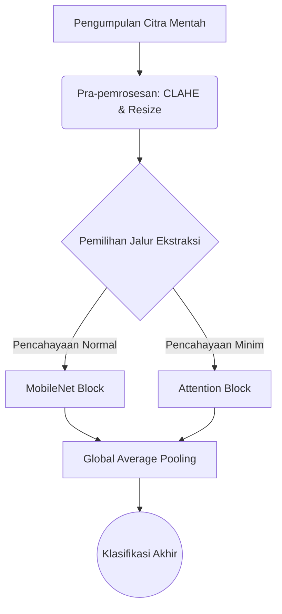

# STANDAR OPERASIONAL & TEMPLATE: BAB II TINJAUAN PUSTAKA
> Dokumen referensi resmi penulisan Bab 2 Tinjauan Pustaka (Standar Akademik Q1 & Pedoman Skripsi/Tesis Universitas di Indonesia).

---

## 🏛️ PEDOMAN ARSITEKTUR BAB II (RULES & CONSTRAINTS)

### 1. Landasan Teori (Theoretical Framework)
- **Kredibilitas & Kebaruan (Recency)**: 
  - Wajib rujukan 5 tahun terakhir untuk teknologi/metode, kecuali *Grand Theory* fundamental.
  - HANYA mengutip jurnal/prosiding *Peer-Reviewed* atau buku teks resmi. **DILARANG KERAS** mengutip Wikipedia, Blog, atau portal berita untuk konsep sains.
- **Hierarki Deduktif (Umum ke Khusus)**: Susun sub-bab dari *Grand Theory* (Topik Makro) $
ightarrow$ Variabel Terikat (Y) $
ightarrow$ Variabel Bebas/Teknis (X).
- **Aturan Anti-Padding (Relevansi Mutlak)**: Hanya masukkan teori yang benar-benar akan digunakan sebagai pisau analisis atau diimplementasikan di Bab 3 (Metodologi). Buang teori *filler* yang menebalkan halaman tanpa makna.
- **Eliminasi AI Slop & Prinsip Seleksi Tunggal (Single-Term Selection)**:
  - DILARANG KERAS menjejerkan istilah ganda yang maknanya sama, baik dengan tanda kurung maupun tanpa tanda kurung (contoh salah AI slop: *kelapa sawit Elaeis guineensis*, *kotak pembatas bounding box*, *tulang punggung backbone*, *buah kecil spikelet*, *lapisan penyatuan pooling layer*).
  - Pilih satu istilah secara tegas: gunakan istilah baku universal komputer/AI dalam cetak miring (*bounding box*, *backbone*, *pooling*, *feature map*, *stride*, *padding*, *receptive field*, *deep learning*) ATAU padanan bahasa Indonesia murni tanpa embel-embel padanan asing.
  - Jangan menyandingkan nama ilmiah Latin jika nama komoditas/objeknya sudah baku di Indonesia (cukup tulis 'kelapa sawit', bukan 'kelapa sawit Elaeis guineensis').
- **Aturan Hemat Tanda Kurung (Parenthesis Economy)**:
  - Tanda kurung HANYA sah untuk:
    1. Tahun sitasi: `(2026)` atau `(Ramadhani dkk., 2026)`.
    2. Singkatan akronim saat pertama kali didefinisikan: `Tandan Buah Segar (TBS)`.
    3. Nomor persamaan matematika: `Persamaan (2.1)`.
    4. Nilai persentase/kadar atau koordinat: `(di atas 20%)` atau $[x_c, y_c, w, h]$.
  - Dilarang membubuhkan terjemahan bahasa Inggris di dalam kurung pada nama fraksi atau istilah umum (tulis lugas: Mentah, Kurang Masak, Masak, Terlalu Masak; BUKAN Mentah (*Unripe*), Masak (*Ripe*)).
- **Definisi Konseptual (Sintesis)**: Dilarang terkena *Dictionary Syndrome* (menjejerkan "Menurut A...", "Menurut B..."). Wajib merajut 3 pandangan ahli menjadi **1 paragraf sintesis** kesimpulan mandiri.
- **Rumus Matematika & Gambar**:
  - Rumus wajib diformat LaTeX Math (`$$...$$`) lalu diikuti **Tabel Dekomposisi Variabel** (simbol, arti/deskripsi variabel, dan satuan SI/rentang nilai).
  - Pada riset deteksi objek visi komputer komparatif, wajib menyertakan penurunan matematis fungsi kerugian multi-tugas: RPN Loss dan Fast R-CNN Loss (Smooth L1) untuk model *two-stage*, serta agregasi BCE Loss, Bounding Box Regression Loss (CIoU), dan Distribution Focal Loss (DFL) untuk model *one-stage anchor-free*.
  - Gambar wajib menggunakan format `` dilengkapi dengan kunci sitasi sumber aslinya `[@citekey]`.
- **Teori Usang**: Jika terpaksa membahas teori lama yang sudah dibantah, sertakan `> [!warning] Outdated Theory` dan bedah kelemahannya berdasarkan literatur modern.

### 2. Penelitian Terdahulu (State-of-the-Art / SOTA)
- **Jumlah**: Bedah secara komprehensif **5 hingga 10 paper** utama (paling relevan).
- **Empat Pilar Narasi**: Setiap paper yang dibahas harus mencakup: (1) Penulis & Tahun, (2) Masalah Riset, (3) Metode/Algoritma, dan (4) Hasil Temuan & Keterbatasannya.
- **Aturan First-Mention Sitasi Dalam Teks**:
  - *Penyebutan Pertama Kali (First-Mention)*: Untuk karya 3 hingga 5 penulis, WAJIB menyebutkan seluruh nama belakang penulis secara lengkap dihubungkan dengan kata 'dan' (misal: "Ramadhani, Dewanta, dan Gunawan (2026)"). Dilarang langsung memotong menjadi singkatan pada pemunculan pertama.
  - *Penyebutan Berikutnya*: Cukup nama pertama diikuti singkatan "dkk." (misal: "Ramadhani dkk. (2026)").
  - *Standarisasi Naskah Indonesia*: Gunakan singkatan resmi "dkk." (bukan "et al.") dan kata hubung "dan" (bukan "&" di narasi). Istilah "et al." hanya untuk naskah bertaraf internasional berbahasa Inggris penuh.
- **Integritas Fakta Empiris (Zero Hallucination Gate)**:
  - Seluruh angka capaian kuantitatif (mAP, akurasi, FPS, ukuran bobot, jumlah sampel dataset) WAJIB diverifikasi langsung dari publikasi primer/asli. Dilarang mengarang angka metrik atau menyimpulkan dari memori tanpa bukti teks paper.
- **Format Judul Tabel Baku (Standar UPNVJ & Gunadarma)**:
  - Format judul tabel: `Tabel X.Y Judul Tabel` (contoh: `Tabel 2.1 Dekomposisi Variabel Faster R-CNN`, `Tabel 2.3 Penelitian Terdahulu`).
  - DILARANG memberi titik setelah nomor sub-bab (BUKAN `Tabel 2.3.` atau `Tabel 2.3. Matriks...`).
  - DILARANG membubuhkan tanda kurung istilah asing pada judul tabel (BUKAN `Tabel 2.3 Matriks Perbandingan Penelitian Terdahulu (State-of-the-Art)`). Judul wajib singkat, padat, dan bermartabat dalam bahasa Indonesia baku.
- **Matriks SOTA (Wajib)**: Setelah narasi paragraf, WAJIB merangkumnya ke dalam tabel **Tabel X.Y Penelitian Terdahulu**.
- **Kolom Standar Matriks**:
  Tabel wajib memuat 6 kolom terstruktur: `Penulis dan Tahun`, `Tautan Artikel` (DOI/arXiv/URL resmi), `Latar Belakang Masalah`, `Hasil Capaian Kuantitatif`, `Kesimpulan Studi`, dan `Relevansi Terhadap Penelitian Ini` (menegaskan posisi penelitian Anda).
- **Tautan Langsung & Verifikasi DOI Terbuka**: Nama peneliti dalam tabel matriks SOTA wajib diberi hyperlink aktif ke sumber dokumen. Di bagian bawah tabel, sediakan blok rujukan bernomor lengkap dengan tautan DOI resmi (`https://doi.org/...`) atau arsip repositori/arXiv (`https://arxiv.org/abs/...`).
- **Aturan Validasi DOI**: Wajib memvalidasi nomor DOI ke Crossref API (`https://api.crossref.org/works/...`) atau arsip penerbit sebelum menuliskannya ke naskah skripsi. Ketidaksesuaian digit sufiks DOI mengarahkan pembaca/penguji ke artikel yang keliru dan merusak kredibilitas akademik saat sidang.
- **Penutup**: Akhiri sub-bab ini dengan **Paragraf Sintesis Research Gap** (Benang merah yang menegaskan kelemahan kolektif paper sebelumnya dan justifikasi solusi Anda).

### 3. Kerangka Pemikiran & Hipotesis
- **Visualisasi & Narasi (Standar Vektor FigGenie)**:
  - Wajib menyediakan **Diagram Alur Visual** yang menunjukkan alur Masalah -> Input -> Pengolahan Inti -> Luaran -> Tolok Ukur.
  - Untuk naskah skripsi final dan persiapan slide sidang, WAJIB digambar menggunakan engine vektor `figgenie-paper-diagram` (format SVG 240pt/504pt, PDF tight-box untuk LaTeX/Typst, dan PPTX native shapes). Kode Mermaid (`graph TD`) hanya digunakan sebagai draf sketsa teks awal.
  - SETELAH diagram, wajib berikan paragraf **Bedah Narasi** yang menguraikan logika panah tersebut secara mendalam.
- **Hipotesis (Hanya untuk Riset Kuantitatif)**:
  - Wajib *Testable* (Dapat Diuji secara statistik), memuat $H_0$ dan $H_1$.
  - Umumnya ditempatkan di akhir Bab 2 atau awal Bab 3.
- **Pengecualian (Rancang Bangun)**: Jika penelitian bersifat murni Rancang Bangun/Rekayasa Perangkat Lunak (tanpa uji statistik/korelasi antar variabel), **Sub-bab Hipotesis DIBUANG / DIHAPUS**.

### 4. Etika Penulisan & Anti-Plagiarisme
- **Reporting Verbs (Kata Kerja Pelaporan)**: Gunakan variasi kata kerja kritis (contoh: *menentang, mengusulkan, membuktikan, menyoroti*). Hindari pengulangan monoton kata "mengatakan".
- **Parafrase Tingkat Tinggi**: Lakukan *Restrukturisasi Total* (Ubah aktif ke pasif, induktif ke deduktif) sambil mempertahankan makna. Dilarang melakukan *Direct Quote* (Kutipan mentah) atau sekadar sinonim (*Spintax*).
- **Standar Sitasi**: Wajib menggunakan *Markdown Citation Keys* (contoh: `[@penulis2024]`).
- **Self-Citation**: Jika mengutip paper sendiri, tulis secara objektif (sudut pandang pihak ketiga) tanpa puji-pujian personal.
- **Hard-Reject Word-Vomit**: Agen akan MENOLAK perintah untuk menebalkan halaman (*padding*). Draf akan dikompresi agar tajam, logis, dan langsung pada intinya.

---

## 📝 TEMPLATE STRUKTUR BAB II TINJAUAN PUSTAKA

```markdown
# BAB II TINJAUAN PUSTAKA

## 2.1 Landasan Teori

### 2.1.1 [Grand Theory / Konsep Payung Utama]
[Paragraf Sintesis: Bahas definisi dari 3-4 sumber berbeda, lalu rajut menjadi satu kesimpulan mandiri tanpa menjejerkan "Menurut A, Menurut B" secara kaku [@sitasi1; @sitasi2].]

### 2.1.2 [Variabel Terikat / Dependent Variable]
[Uraikan mengapa variabel ini penting. Jika ada gambar arsitektur:]
  
*Gambar 2.1: Arsitektur Vision Transformer (Sumber: [@dosovitskiy2020])*

### 2.1.3 [Variabel Bebas / Metode Teknis yang Digunakan]
[Jelaskan cara kerja algoritma. Jika melibatkan matematika, gunakan LaTeX:]
Fungsi kerugian (Loss Function) yang dioptimasi pada model ini diekspresikan pada Persamaan 2.1:

$$ L(y, \hat{y}) = -\frac{1}{N} \sum_{i=1}^{N} y_i \log(\hat{y}_i) $$

**Tabel 2.1 Dekomposisi Variabel Persamaan Cross-Entropy**
| Simbol | Deskripsi | Satuan / Rentang |
|:---:|:---|:---:|
| $L$ | Nilai fungsi kerugian (*Loss*) | $[0, \infty)$ |
| $N$ | Jumlah sampel dalam satu *batch* | Integer |
| $y_i$ | Nilai target aktual (Ground Truth) | $\{0, 1\}$ |
| $\hat{y}_i$ | Probabilitas prediksi dari jaringan model | $[0, 1]$ |

## 2.2 Penelitian Terdahulu
Penelitian ini dibangun di atas fondasi riset-riset sebelumnya yang berfokus pada optimasi [Topik Riset].

Penelitian pertama dilakukan oleh [@penulisA2022] yang bertujuan memecahkan masalah inefisiensi waktu komputasi pada *edge device*. Mereka mengusulkan algoritma *MobileNetV3* dan berhasil mencapai akurasi 92%. Namun, penelitian ini memiliki keterbatasan karena tidak mampu menangani kondisi pencahayaan minim. 

Selanjutnya, [@penulisB2023] membuktikan bahwa penambahan modul *Attention* dapat mengatasi masalah pencahayaan. Mereka menggunakan dataset *NightVision-DB*, tetapi arsitektur tersebut membutuhkan VRAM sangat besar, membatasi aplikasinya pada perangkat server murni.

[Lanjutkan hingga 5-10 paper utama...]

**Tabel 2.2 Penelitian Terdahulu**

| Penulis dan Tahun | Tautan Artikel | Latar Belakang Masalah | Hasil Capaian Kuantitatif | Kesimpulan Studi | Relevansi Terhadap Penelitian Ini |
|:---|:---|:---|:---|:---|:---|
| PenulisA dkk. (2022) | [DOI / URL] | Deteksi wajah cepat di perangkat bergerak | Akurasi mencapai 92,00% pada 30 FPS | Arsitektur efisien namun akurasi menurun pada pencahayaan minim | Menjadi pembanding model ringan; penelitian ini menambahkan modul robust terhadap iluminasi |
| PenulisB dan PenulisC (2023) | [DOI / URL] | Optimasi akurasi pada variasi pencahayaan | Akurasi mencapai 95,50% namun membutuhkan memori besar | Modul attention efektif meningkatkan akurasi namun beban VRAM tinggi | Mengadopsi mekanisme attention teroptimasi agar tetap efisien di GPU komputasi terbatas |
| **Penelitian Ini** | - | Evaluasi komparatif model deteksi objek pada kondisi pencahayaan dinamis | Target mAP > 85,00% dengan inferensi real-time | Komparasi empiris terkontrol dengan partisi data anti-bocor | **Fokus menguji komparasi langsung dua tahap vs satu tahap dengan dataset representatif** |

Berdasarkan komparasi pada Tabel 2.2, *research gap* yang belum terselesaikan oleh literatur saat ini adalah absennya arsitektur yang ringan secara komputasi namun tangguh terhadap variasi pencahayaan ekstrem. Oleh karena itu, penelitian ini diposisikan untuk mengisi celah tersebut dengan mengusulkan arsitektur hibrida.

## 2.3 Kerangka Pemikiran
Kerangka pemikiran menggambarkan alur logika penelitian dari hulu ke hilir. Secara konseptual, tahapan sistem yang diusulkan divisualisasikan pada Gambar 2.2:


*Gambar 2.2: Skema Kerangka Pemikiran Konseptual Sistem*

Berdasarkan Gambar 2.2, aliran data dimulai dari pengumpulan citra mentah yang kemudian dikenakan operasi pra-pemrosesan CLAHE untuk meratakan histogram kecerahan. Sistem kemudian menerapkan logika percabangan fitur; di mana fitur dengan iluminasi normal diproses melalui blok *MobileNet* konvensional, sedangkan area gelap diperkuat melalui blok *Attention* sebelum keduanya diagregasikan di lapisan klasifikasi akhir.

## 2.4 Hipotesis Penelitian
*(Catatan: Hapus sub-bab ini jika penelitian murni berjenis Rancang Bangun/Rekayasa Perangkat Lunak)*

Berdasarkan kajian pustaka dan kerangka pemikiran di atas, hipotesis yang diajukan dalam penelitian ini adalah:
- **$H_0$**: Tidak terdapat perbedaan akurasi dan latensi inferensi yang signifikan antara model konvensional dan arsitektur hibrida yang diusulkan.
- **$H_1$**: Arsitektur hibrida yang diusulkan memiliki tingkat akurasi yang lebih tinggi dengan latensi inferensi yang tetap kompetitif secara statistik dibandingkan model konvensional.
```
