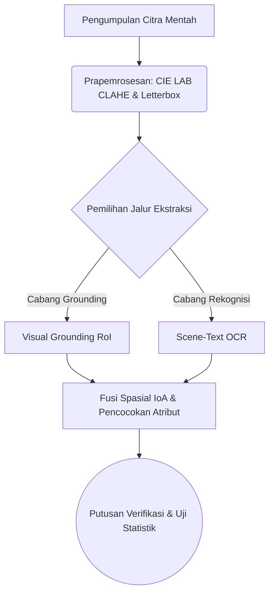

# STANDAR OPERASIONAL & TEMPLATE: BAB II TINJAUAN PUSTAKA
> Dokumen referensi resmi penulisan Bab 2 Tinjauan Pustaka (Standar Akademik Q1 & Pedoman Skripsi/Tesis Universitas di Indonesia).

---

## 🏛️ PEDOMAN ARSITEKTUR BAB II (RULES & CONSTRAINTS)

### 1. Landasan Teori (Theoretical Framework)
- **Kredibilitas & Kebaruan (Recency)**: 
  - Wajib rujukan 5 tahun terakhir untuk teknologi/metode, kecuali *Grand Theory* fundamental.
  - HANYA mengutip jurnal/prosiding *Peer-Reviewed* atau buku teks resmi. **DILARANG KERAS** mengutip Wikipedia, Blog, atau portal berita untuk konsep sains.
- **Hierarki Deduktif 5-Lapis (Standar Korpus FIK UPNVJ)**:
  Urutan sub-bab pada Bab 2 wajib mengalir secara deduktif dari objek masalah fisik ke instrumen komputasi:
  1. *Sub-Bab Objek / Domain Lapangan* (contoh: `2.1 Tandan Buah Segar Kelapa Sawit`, `2.1 Katalog E-Commerce Kosmetik`, `2.1 Karakteristik Deret Waktu Saham`). Membahas definisi domain, klasifikasi/taksonomi resmi, dan standar regulasi.
  2. *Sub-Bab Representasi & Prapemrosesan Data* (contoh: `2.2 Citra Digital`, `2.3 Pengolahan Citra Digital`, `2.3 Text Preprocessing`). Membahas representasi matematis masukan $f(x, y)$ dan transformasi awal.
  3. *Sub-Bab Paradigma & Arsitektur Inti* (contoh: `2.4 Deep Learning`, `2.5 Convolutional Neural Network`, `2.5 Vision-Language Model`). Membahas struktur lapisan, ekstraksi fitur, dan alur propagasi maju.
  4. *Sub-Bab Algoritma Spesifik & Fungsi Objektif* (contoh: `2.6 Arsitektur Florence-2`, `2.7 PaddleOCR PP-OCRv4`, `2.8 Evaluasi Metrik dan Uji McNemar`). Membahas persamaan matematis fungsi kerugian (*loss function*) dan metrik evaluasi.
  5. *Sub-Bab Penelitian Terdahulu* (`2.9 Penelitian Terdahulu`): Narasi komparatif 5 sampai 10 studi primer, Tabel Penelitian Terdahulu, dan Paragraf Sintesis Research Gap.
- **Pola Gaya Paragraf Sintesis Teori (4-Sentence Theoretical Paragraph Style Korpus UPNVJ)**:
  Setiap sub-bab teori wajib disusun dalam 2 hingga 3 paragraf kohesif di mana setiap paragraf mematuhi struktur 4 kalimat deduktif dingin:
  1. *Kalimat 1 (Definisi Fungsional / Ontologis)*: Langsung mendefinisikan konsep secara teknis tanpa kalimat pembuka hiperbolis. Contoh baku: *"Citra digital merupakan representasi visual dua dimensi $f(x, y)$ yang terbentuk dari kuantisasi sinyal kontinu menjadi matriks piksel diskrit (Gonzalez dan Woods, 2018)."*
  2. *Kalimat 2 (Mekanisme Operasional / Matematis)*: Menguraikan cara kerja internal, transformasi variabel, atau cara komponen berinteraksi. Contoh baku: *"Pada fungsi tersebut, koordinat spasial $x$ dan $y$ menentukan lokasi elemen gambar, sedangkan nilai amplitudo $f$ merepresentasikan intensitas luminansi atau kanal warna pada rentang integer $[0, 255]$."*
  3. *Kalimat 3 (Karakteristik Kritis / Trade-off Komputasi)*: Menjelaskan keunggulan spesifik sekaligus batasan teknis metode tersebut. Contoh baku: *"Representasi matriks memungkinkan operasi konvolusi paralel berkecepatan tinggi, namun variasi pencahayaan ekstrem saat akuisisi citra dapat menggeser distribusi histogram dan menurunkan ketajaman fitur tepi."*
  4. *Kalimat 4 (Jangkar Relevansi terhadap Penelitian)*: Menjelaskan peran langsung konsep tersebut pada pipeline yang dibangun di Bab 3. Contoh baku: *"Oleh sebab itu, penelitian ini menerapkan normalisasi ruang warna CIE LAB dan penyetaraan kontras adaptif sebelum citra dimasukkan ke jaringan detektor objek."*
- **Pola Sintesis Multi-Rujukan (Anti-Dictionary Syndrome)**:
  - DILARANG KERAS menulis paragraf daftar kamus: *"Menurut Penulis A (2021), X adalah... Menurut Penulis B (2022), X merupakan... Sedangkan menurut Penulis C (2023), X didefinisikan sebagai..."*.
  - WAJIB menggunakan **Pola Sintesis Konvergen/Kontrastif**: Rajut gagasan dari 2 hingga 3 rujukan ke dalam satu klaim konseptual terpadu dengan sitasi di akhir klausa atau di awal argumen. Contoh baku: *"Ekstraksi fitur konvolusional bekerja dengan memindai bidang reseptif lokal menggunakan filter terlatih untuk menghasilkan peta aktivasi hierarkis (Lecun dkk., 2015; He, Zhang, Ren, dan Sun, 2016)."*
- **Transisi Kohesif Antar-Paragraf & Eliminasi Klausa "Di Mana"**:
  - Hubungan antarkalimat dan antarparagraf wajib menggunakan penanda transisi logis baku EYD V (*Sehubungan dengan hal tersebut, Berdasarkan mekanisme tersebut, Berbeda dengan pendekatan satu tahap, Sebaliknya, Oleh karena itu*).
  - DILARANG KERAS menggunakan kata *"di mana"* atau *"yang mana"* sebagai kata sambung penjelas non-spasial. Ganti dengan kata *"ketika"*, *"yang"*, *"sehingga"*, tanda titik dua (`:`), atau pecah menjadi kalimat baru.
- **Aturan Anti-Padding (Relevansi Mutlak)**: Hanya masukkan teori yang benar-benar akan digunakan sebagai pisau analisis atau diimplementasikan di Bab 3 (Metodologi). Buang teori *filler* yang menebalkan halaman tanpa makna.
- **Eliminasi AI Slop & Prinsip Seleksi Tunggal (Single-Term Selection)**:
  - DILARANG KERAS menjejerkan istilah ganda yang maknanya sama, baik dengan tanda kurung maupun tanpa tanda kurung (contoh salah AI slop: *kelapa sawit Elaeis guineensis*, *kotak pembatas bounding box*, *tulang punggung backbone*, *buah kecil spikelet*, *lapisan penyatuan pooling layer*).
  - Pilih satu istilah secara tegas: gunakan istilah baku universal komputer/AI dalam cetak miring (*bounding box*, *backbone*, *pooling*, *feature map*, *stride*, *padding*, *receptive field*, *deep learning*) ATAU padanan bahasa Indonesia murni tanpa embel-embel padanan asing.
  - Jangan menyandingkan nama ilmiah Latin jika nama komoditas/objeknya sudah baku di Indonesia (cukup tulis 'kelapa sawit', bukan 'kelapa sawit Elaeis guineensis').
- **Aturan Hemat Tanda Kurung (Parenthesis Economy)**:
  - Tanda kurung HANYA sah untuk:
    1. Tahun sitasi: `(2026)` atau `(Ramadhani dkk., 2026)`.
    2. Singkatan akronim saat pertama kali didefinisikan: `Tandan Buah Segar (TBS)`.
    3. Nomor persamaan matematika: `Persamaan (2.1)`.
    4. Nilai persentase/kadar atau koordinat: `(di atas 20%)` atau $[x_c, y_c, w, h]$.
  - Dilarang membubuhkan terjemahan bahasa Inggris di dalam kurung pada nama fraksi atau istilah umum (tulis lugas: Mentah, Kurang Masak, Masak, Terlalu Masak; BUKAN Mentah (*Unripe*), Masak (*Ripe*)).
- **Definisi Konseptual (Sintesis)**: Dilarang terkena *Dictionary Syndrome* (menjejerkan "Menurut A...", "Menurut B..."). Wajib merajut 3 pandangan ahli menjadi **1 paragraf sintesis** kesimpulan mandiri.
- **Rumus Matematika & Gambar**:
  - Rumus wajib diformat LaTeX Math (`$$...$$`) lalu diikuti **Tabel Dekomposisi Variabel** (simbol, arti/deskripsi variabel, dan satuan SI/rentang nilai).
  - Pada riset deteksi objek visi komputer komparatif, wajib menyertakan penurunan matematis fungsi kerugian multi-tugas: RPN Loss dan Fast R-CNN Loss (Smooth L1) untuk model *two-stage*, serta agregasi BCE Loss, Bounding Box Regression Loss (CIoU), dan Distribution Focal Loss (DFL) untuk model *one-stage anchor-free*.
  - Gambar wajib menggunakan format `` dilengkapi dengan kunci sitasi sumber aslinya `[@citekey]`.
- **Teori Usang**: Jika terpaksa membahas teori lama yang sudah dibantah, sertakan `> [!warning] Outdated Theory` dan bedah kelemahannya berdasarkan literatur modern.

### 2. Penelitian Terdahulu (State-of-the-Art / SOTA)
- **Jumlah**: Bedah secara komprehensif **5 hingga 10 paper** utama (paling relevan).
- **Empat Pilar Narasi**: Setiap paper yang dibahas harus mencakup: (1) Penulis & Tahun, (2) Masalah Riset, (3) Metode/Algoritma, dan (4) Hasil Temuan & Keterbatasannya.
- **Aturan First-Mention Sitasi Dalam Teks**:
  - *Penyebutan Pertama Kali (First-Mention)*: Untuk karya 3 hingga 5 penulis, WAJIB menyebutkan seluruh nama belakang penulis secara lengkap dihubungkan dengan kata 'dan' (misal: "Ramadhani, Dewanta, dan Gunawan (2026)"). Dilarang langsung memotong menjadi singkatan pada pemunculan pertama.
  - *Penyebutan Berikutnya*: Cukup nama pertama diikuti singkatan "dkk." (misal: "Ramadhani dkk. (2026)").
  - *Standarisasi Naskah Indonesia*: Gunakan singkatan resmi "dkk." (bukan "et al.") dan kata hubung "dan" (bukan "&" di narasi). Istilah "et al." hanya untuk naskah bertaraf internasional berbahasa Inggris penuh.
- **Integritas Fakta Empiris (Zero Hallucination Gate)**:
  - Seluruh angka capaian kuantitatif (mAP, akurasi, FPS, ukuran bobot, jumlah sampel dataset) WAJIB diverifikasi langsung dari publikasi primer/asli. Dilarang mengarang angka metrik atau menyimpulkan dari memori tanpa bukti teks paper.
- **Format Judul Tabel Baku (Standar UPNVJ & Gunadarma)**:
  - Format judul tabel: `Tabel X.Y Judul Tabel` (contoh: `Tabel 2.1 Dekomposisi Variabel Faster R-CNN`, `Tabel 2.3 Penelitian Terdahulu`).
  - DILARANG memberi titik setelah nomor sub-bab (BUKAN `Tabel 2.3.` atau `Tabel 2.3. Matriks...`).
  - DILARANG membubuhkan tanda kurung istilah asing pada judul tabel (BUKAN `Tabel 2.3 Matriks Perbandingan Penelitian Terdahulu (State-of-the-Art)`). Judul wajib singkat, padat, dan bermartabat dalam bahasa Indonesia baku.
- **Matriks SOTA (Wajib)**: Setelah narasi paragraf, WAJIB merangkumnya ke dalam tabel **Tabel X.Y Penelitian Terdahulu**.
- **Kolom Standar Matriks**:
  Tabel wajib memuat 6 kolom terstruktur: `Penulis dan Tahun`, `Tautan Artikel` (DOI/arXiv/URL resmi), `Latar Belakang Masalah`, `Hasil Capaian Kuantitatif`, `Kesimpulan Studi`, dan `Relevansi Terhadap Penelitian Ini` (menegaskan posisi penelitian Anda).
- **Tautan Langsung & Verifikasi DOI Terbuka**: Nama peneliti dalam tabel matriks SOTA wajib diberi hyperlink aktif ke sumber dokumen. Di bagian bawah tabel, sediakan blok rujukan bernomor lengkap dengan tautan DOI resmi (`https://doi.org/...`) atau arsip repositori/arXiv (`https://arxiv.org/abs/...`).
- **Aturan Validasi DOI**: Wajib memvalidasi nomor DOI ke Crossref API (`https://api.crossref.org/works/...`) atau arsip penerbit sebelum menuliskannya ke naskah skripsi. Ketidaksesuaian digit sufiks DOI mengarahkan pembaca/penguji ke artikel yang keliru dan merusak kredibilitas akademik saat sidang.
- **Penutup**: Akhiri sub-bab ini dengan **Paragraf Sintesis Research Gap** (Benang merah yang menegaskan kelemahan kolektif paper sebelumnya dan justifikasi solusi Anda).

### 3. Kerangka Pemikiran & Hipotesis
- **Visualisasi & Narasi (Standar Vektor FigGenie)**:
  - Wajib menyediakan **Diagram Alur Visual** yang menunjukkan alur Masalah -> Input -> Pengolahan Inti -> Luaran -> Tolok Ukur.
  - Untuk naskah skripsi final dan persiapan slide sidang, WAJIB digambar menggunakan engine vektor `figgenie-paper-diagram` (format SVG 240pt/504pt, PDF tight-box untuk LaTeX/Typst, dan PPTX native shapes). Kode Mermaid (`graph TD`) hanya digunakan sebagai draf sketsa teks awal.
  - SETELAH diagram, wajib berikan paragraf **Bedah Narasi** yang menguraikan logika panah tersebut secara mendalam.
- **Hipotesis (Hanya untuk Riset Kuantitatif)**:
  - Wajib *Testable* (Dapat Diuji secara statistik), memuat $H_0$ dan $H_1$.
  - Umumnya ditempatkan di akhir Bab 2 atau awal Bab 3.
- **Pengecualian (Rancang Bangun)**: Jika penelitian bersifat murni Rancang Bangun/Rekayasa Perangkat Lunak (tanpa uji statistik/korelasi antar variabel), **Sub-bab Hipotesis DIBUANG / DIHAPUS**.

### 4. Etika Penulisan & Anti-Plagiarisme
- **Reporting Verbs (Kata Kerja Pelaporan)**: Gunakan variasi kata kerja kritis (contoh: *menentang, mengusulkan, membuktikan, menyoroti*). Hindari pengulangan monoton kata "mengatakan".
- **Parafrase Tingkat Tinggi**: Lakukan *Restrukturisasi Total* (Ubah aktif ke pasif, induktif ke deduktif) sambil mempertahankan makna. Dilarang melakukan *Direct Quote* (Kutipan mentah) atau sekadar sinonim (*Spintax*).
- **Standar Sitasi**: Wajib menggunakan *Markdown Citation Keys* (contoh: `[@penulis2024]`).
- **Self-Citation**: Jika mengutip paper sendiri, tulis secara objektif (sudut pandang pihak ketiga) tanpa puji-pujian personal.
- **Hard-Reject Word-Vomit**: Agen akan MENOLAK perintah untuk menebalkan halaman (*padding*). Draf akan dikompresi agar tajam, logis, dan langsung pada intinya.

---

## 📝 TEMPLATE STRUKTUR BAB II TINJAUAN PUSTAKA

```markdown
# BAB II TINJAUAN PUSTAKA

## 2.1 [Objek / Domain Masalah Lapangan, maks 2-4 kata]
[Paragraf 1 - Formula 4 Kalimat: (1) Definisi ontologis entitas dan payung regulasi resmi, (2) Karakteristik parameter penentu kualitas/masalah, (3) Analisis kegagalan prosedur konvensional/manual di lapangan, (4) Jangkar relevansi mengapa objek ini membutuhkan ekstraksi/deteksi otomatis.]

## 2.2 [Representasi Sinyal / Prapemrosesan Data]
[Paragraf Sintesis Konvergen: Rajut definisi matematis dari 2-3 sumber primer menjadi satu kesimpulan terpadu tanpa menjejerkan "Menurut A, Menurut B" secara kaku. Uraikan representasi matriks $f(x, y)$ dan peran transformasi prapemrosesan.]

## 2.3 [Arsitektur Model & Fungsi Objektif]
[Uraikan mekanisme kerja lapisan jaringan dan penurunan rumus matematis. Setiap persamaan wajib diikuti penjelasan parameter atau Tabel Dekomposisi Variabel:]
Fungsi kerugian yang dioptimasi pada model ini diekspresikan pada Persamaan (2.1):

$$ L(y, \hat{y}) = -\frac{1}{N} \sum_{i=1}^{N} y_i \log(\hat{y}_i) \quad (2.1) $$

Tabel 2.1 Dekomposisi Variabel Persamaan Cross-Entropy
| Simbol | Deskripsi | Satuan / Rentang |
|:---:|:---|:---:|
| $L$ | Nilai fungsi kerugian | $[0, \infty)$ |
| $N$ | Jumlah sampel dalam satu *batch* | Integer |
| $y_i$ | Nilai target aktual (*ground truth*) | $\{0, 1\}$ |
| $\hat{y}_i$ | Probabilitas prediksi dari jaringan model | $[0, 1]$ |

## 2.4 Penelitian Terdahulu
Penelitian ini dibangun di atas evaluasi kritis terhadap studi terdahulu yang berfokus pada optimasi [Topik Riset].

Penelitian pertama oleh PenulisA, PenulisB, dan PenulisC (2022) mengevaluasi masalah inefisiensi waktu komputasi deteksi objek pada perangkat bergerak. Studi tersebut menerapkan arsitektur *MobileNetV3* dan mencatat akurasi sebesar 92,00% pada laju 30 FPS. Meskipun efisien secara komputasi, model tersebut mengalami penurunan akurasi yang tajam pada citra dengan pencahayaan minim.

Selanjutnya, PenulisD dan PenulisE (2023) mengintegrasikan modul *spatial attention* pada jaringan konvolusional untuk mengatasi degradasi iluminasi pada dataset *NightVision-DB*. Pendekatan tersebut meningkatkan akurasi hingga 95,50%, namun membutuhkan alokasi memori VRAM yang besar sehingga tidak dapat dijalankan pada infrastruktur komputasi terbatas.

[Lanjutkan sintesis 5-10 paper utama dengan pola 4-unsur: Penulis & Tahun First-Mention -> Masalah & Objek -> Metode -> Capaian Metrik Kuantitatif & Keterbatasan...]

Tabel 2.2 Penelitian Terdahulu

| Penulis dan Tahun | Tautan Artikel | Latar Belakang Masalah | Hasil Capaian Kuantitatif | Kesimpulan Studi | Relevansi Terhadap Penelitian Ini |
|:---|:---|:---|:---|:---|:---|
| PenulisA, PenulisB, dan PenulisC (2022) | [DOI / URL] | Deteksi objek cepat pada perangkat bergerak | Akurasi mencapai 92,00% pada 30 FPS | Arsitektur efisien namun akurasi menurun pada pencahayaan minim | Menjadi pembanding model ringan; penelitian ini menambahkan normalisasi kontras CIE LAB CLAHE |
| PenulisD dan PenulisE (2023) | [DOI / URL] | Optimasi akurasi pada variasi pencahayaan ekstrem | Akurasi mencapai 95,50% namun membutuhkan memori besar | Modul *attention* efektif meningkatkan akurasi namun beban VRAM tinggi | Mengadopsi isolasi *Region of Interest* terarah agar tetap hemat memori |
| **Penelitian Ini** | - | Evaluasi komparatif model pada kondisi pencahayaan dan kemasan dinamis | Target akurasi > 85,00% dengan uji signifikansi statistik | Komparasi empiris terkontrol dengan partisi data anti-bocor | **Mengisi celah efisiensi dan ketangguhan melalui pipeline hibrida terverifikasi** |

Berdasarkan komparasi pada Tabel 2.2, celah penelitian (*research gap*) yang belum diselesaikan oleh literatur terdahulu adalah ketiadaan arsitektur yang mampu menjaga presisi ekstraksi fitur pada kondisi pencahayaan tidak merata tanpa mengorbankan efisiensi komputasi. Oleh karena itu, penelitian ini diposisikan untuk mengisi celah tersebut melalui penggabungan lokalisasi wilayah terarah dan pengenalan karakter berpresisi tinggi.

## 2.5 Kerangka Pemikiran
Kerangka pemikiran memetakan alur logika penelitian dari identifikasi masalah hingga evaluasi akhir. Secara konseptual, tahapan sistem yang diusulkan divisualisasikan pada Gambar 2.1:


Gambar 2.1 Skema Kerangka Pemikiran Konseptual Sistem

Berdasarkan Gambar 2.1, aliran pemrosesan dimulai dari akuisisi citra mentah yang kemudian dikenakan normalisasi kontras CIE LAB CLAHE untuk meratakan distribusi luminansi sebelum penempatan kanvas *letterbox*. Sistem selanjutnya menjalankan dua cabang pemrosesan paralel: cabang pertama melokalisasi wilayah kandidat menggunakan *visual grounding*, sedangkan cabang kedua mengekstraksi deretan karakter menggunakan mesin OCR, yang kemudian digabungkan melalui aturan fusi spasial untuk menghasilkan putusan verifikasi akhir.

## 2.4 Hipotesis Penelitian
*(Catatan: Hapus sub-bab ini jika penelitian murni berjenis Rancang Bangun/Rekayasa Perangkat Lunak)*

Berdasarkan kajian pustaka dan kerangka pemikiran di atas, hipotesis yang diajukan dalam penelitian ini adalah:
- **$H_0$**: Tidak terdapat perbedaan akurasi dan latensi inferensi yang signifikan antara model konvensional dan arsitektur hibrida yang diusulkan.
- **$H_1$**: Arsitektur hibrida yang diusulkan memiliki tingkat akurasi yang lebih tinggi dengan latensi inferensi yang tetap kompetitif secara statistik dibandingkan model konvensional.
```
